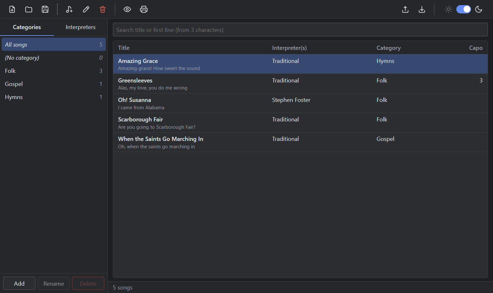

# SimpleLyrics

SimpleLyrics is a cross-platform desktop app for guitar players. It stores songs (title, key, capo, chords, lyrics, interpreters, category) in SQLite files, lets you search and organise them, and prints a clean song sheet.

The UI language is English.

## Features

- One songbook per file: each database is a `.sng` file that you can copy, back up or move.
- Songs with title, key, original key, first line, capo (0–12), chords, lyrics, one category and any number of interpreters.
- Sidebar to browse by category or interpreter, with song counts.
- Search by title and first line, from 3 characters, with Unicode-aware matching.
- Preview and print of a single song (black on white, A4 layout, auto-fitted font size).
- Chord diagrams for the chords used in a song, shown above the chords text in the preview and print-out.
- A chord lookup page with the standard fingerings of every chord, including barre chords.
- Export and import of songs as JSON.
- Dark (default) and light theme.



## Quick start

### Use the app

Follow [Tutorial: Your first song](__documentation/tutorial-first-song.md).

### Run it from source

Prerequisites: Node.js and npm.

```powershell
npm install
npm run dev
```

If the app does not start because `electron.exe` is missing, see [How to build, test and package](__documentation/how-to-build-and-package.md#fix-a-missing-electron-binary).

## Documentation

The documentation follows the [Diátaxis](https://diataxis.fr/) framework.

### Tutorial

- [Your first song](__documentation/tutorial-first-song.md): create a file, add a song, search, see its chord diagrams, look up a chord, and print it.

### How-to guides

- [Manage categories and interpreters](__documentation/how-to-manage-categories-and-interpreters.md)
- [Use chord diagrams](__documentation/how-to-use-chord-diagrams.md)
- [Export and import songs](__documentation/how-to-export-import-songs.md)
- [Build, test and package](__documentation/how-to-build-and-package.md)
- [Change the database schema](__documentation/how-to-change-the-database-schema.md)

### Reference

- [User interface and keyboard shortcuts](__documentation/reference-ui-and-shortcuts.md)
- [Data model and limits](__documentation/reference-data-model-and-limits.md)
- [Chord notation and diagrams](__documentation/reference-chord-notation-and-diagrams.md)
- [Export file format](__documentation/reference-export-format.md)
- [Commands, stack and code map](__documentation/reference-commands-and-code-map.md)

### Explanation

- [Architecture](__documentation/explanation-architecture.md)
- [Design decisions and gotchas](__documentation/explanation-design-decisions.md)
- [Roadmap and known gaps](__documentation/roadmap-and-known-gaps.md)

## License

MIT. See [LICENSE](LICENSE).