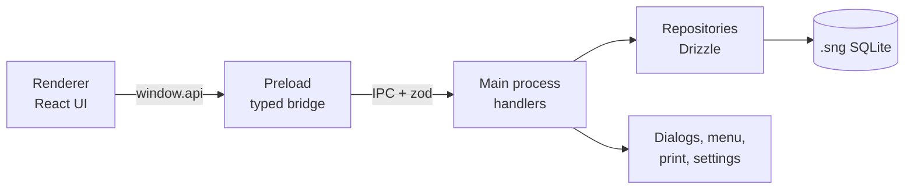

# Explanation: Architecture

This document describes how SimpleLyrics is structured and why. For file locations see [Commands, stack and code map](reference-commands-and-code-map.md).

## One songbook, one file

A songbook is a single SQLite file (`.sng`). There is no central database. Users can copy, back up or send a file, and open several songbooks one after the other. The app has exactly one open file at a time. It remembers the last one and a list of recent files in a separate settings file.

To protect users from opening unrelated databases, the app only accepts SQLite files that carry its own marker in the `app_meta` table.

## Three layers

- **Renderer** (`src/renderer`): React UI. It has no access to Node or the file system and talks only to `window.api`.
- **Preload** (`src/preload`): exposes a typed `window.api` object. The interface `SimpleLyricsApi` lives in `src/shared/types.ts`, so both sides share one contract.
- **Main process** (`src/main`): owns the database, native dialogs, the menu, printing and settings.

## IPC and validation

The renderer is treated as untrusted input. Every IPC call is validated with zod in `ipc/validation.ts` before it reaches a repository. Results use the shape `ApiResult<T>` (`{ ok: true, data }` or `{ ok: false, error }`), so the UI shows readable messages instead of raw exceptions. Errors the user can fix are thrown as `UserError`; anything else is reported as an unexpected error.

The main process also pushes events to the renderer: `menu:command` for menu actions, and notifications when the database or its data changed (for example after an import).

## Repositories

`repositories/` contains all SQL access, written with Drizzle. Writes that touch several tables, such as saving a song together with a new category and new interpreters, run in one transaction. The repositories take a database object as a parameter, which allows the tests to run them against a temporary SQLite file in plain Node.

## Renderer state

`App.tsx` holds the state and switches between four views: list, edit, preview and chord lookup. The editor replaces the whole window content instead of opening in a dialog. This keeps the form large enough for chords and lyrics and avoids half-saved states: there are only Cancel and Save. The chord lookup is opened by the menu command `show-chords` and is ignored while the editor is open.

## Chord diagrams

Chord diagrams need no database and no main-process code. `src/shared/chords.ts` is a pure module that parses chord names, extracts the chords from a song's chords text and returns fingerings. The renderer draws them as SVG in `ChordDiagram.tsx`, and both the preview sheet and the lookup page use that component. The module has no dependency on Electron or React, so the tests run it directly in Node.

## Printing

Preview and print use the same sheet component. For printing, `@media print` forces black on white and sets the margins, and the main process opens the system print dialog. See [Design decisions and gotchas](explanation-design-decisions.md) for the font fitting.

## Packaging

electron-builder packages the compiled output, ships the `drizzle/` folder as an extra resource and unpacks `*.node` files so the native SQLite module can be loaded.
