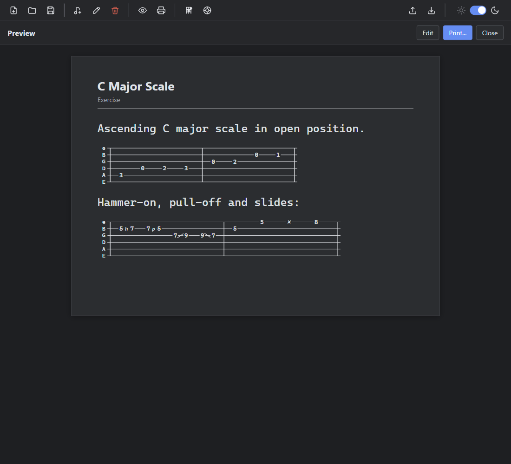

# How to add a guitar tab to a song

SimpleLyrics turns guitar tablature written as text into a drawn tab in the preview and the print-out. This guide shows how to write one and what to check if it stays plain text.

For the exact detection rules and symbols, see [Reference: Tab notation](reference-tab-notation.md).

## Add a tab

1. Open the song in the editor (select it, then **Edit song**).
2. In the **Song text** field, type or paste the tab on consecutive lines. Put a blank line before and after it to keep it apart from the lyrics:

   ```text
   Ascending C major scale in open position.

   e|----------------|----------------|
   B|----------------|---------0---1--|
   G|----------------|-0---2----------|
   D|-----0---2---3--|----------------|
   A|-3--------------|----------------|
   E|----------------|----------------|
   ```

3. Choose **Save**, then **Preview song**.

The tab is drawn with six string lines, the string names on the left, bar lines and the fret numbers on the lines. The text around it is shown as before.



Tabs belong in the **Song text** field only. The **Chords used** field is for chord names, and a tab there would not be drawn.

## Write the tab so it is recognised

- Use one line per string, in the order top to bottom as you want it shown. A guitar tab has 6 lines, a bass tab has 4. Between 4 and 8 lines are accepted.
- Start each line with the string name (`e B G D A E`) followed by `|`.
- Use `-` for the empty spaces and digits for the frets. Keep all lines the same length, so that notes played together are in the same column.
- Use the usual symbols for techniques: `h` hammer-on, `p` pull-off, `/` and `\` slides, `b` bend, `~` vibrato, `x` muted note.
- Separate bars with `|` in the same column on every line.

Several tabs can follow each other. Write the string names on every line, and a new tab starts when a string name repeats.

## Long tabs

A tab that is wider than 56 characters is split into several rows at the bar lines, so that it fits the page. Each row starts and ends with a bar line, and repeats the string names. Write your tab on as many lines as you like. There is no need to cut it yourself.

## If the tab stays plain text

| Cause | What to do |
|---|---|
| Fewer than 4 consecutive tab lines | Check for a blank line or a line of text in the middle of the tab. |
| A line contains other letters or words, such as a comment | Move the comment to its own line outside the tab. |
| A line has fewer than 3 dashes | Fill the empty space with `-`. |
| The tab was typed in the **Chords used** field | Move it to the **Song text** field. |

## Print the tab

Choose **Print song** in the preview. The tab is printed in black on white, together with the rest of the sheet.

## See also

- [Reference: Tab notation](reference-tab-notation.md)
- [How to use chord diagrams](how-to-use-chord-diagrams.md)
