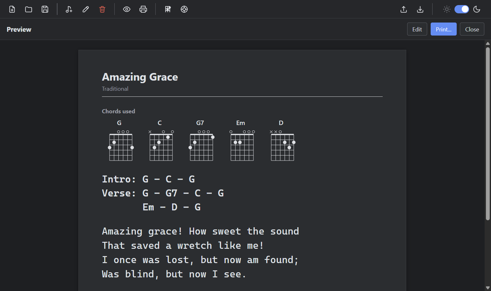
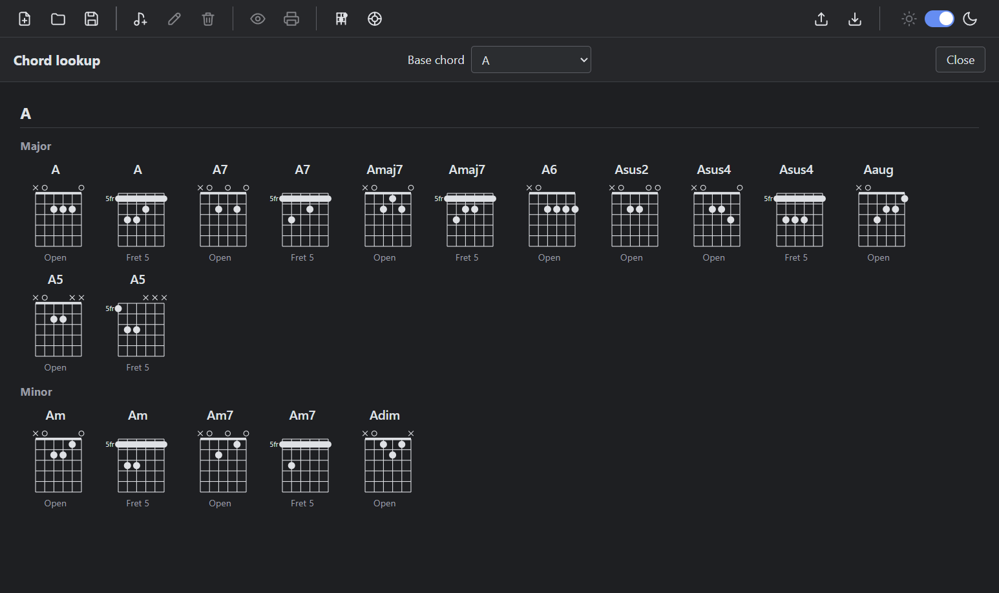

# How to use chord diagrams

SimpleLyrics draws guitar chord diagrams from the text in the **Chords used** field of a song. This guide shows how to get the diagrams into the preview and print-out, and how to find other ways to play a chord.

For the exact notation rules, see [Reference: Chord notation and diagrams](reference-chord-notation-and-diagrams.md).

## Show the chords of a song as diagrams

1. Open the song in the editor (select it, then **Edit song**).
2. In the **Chords used** field, write the chords with an optional label in front. All of these work:

   ```text
   Intro: G - G - C - Em
   Verse: C-G-Em-D
   Chorus: Em - C - G
   ```

   Chords can also go on a line of their own, without a label, if the line contains nothing but chords:

   ```text
   G C D G
   ```

3. Choose **Save**, then **Preview song**.

The **Chords used** section above the chords text now shows one diagram for each distinct chord. A chord used in the intro, the verse and the chorus is shown once. The chords text itself is printed exactly as you wrote it.



## Fix a chord that does not appear

| What you see | Cause | What to do |
|---|---|---|
| The chord is missing | The line has no label and contains other words, so it is treated as ordinary text. | Add a label, for example `Verse:`, or put the chords on a line without words. |
| The chord is missing | The name is not valid, for example lower case `am` or `H`. | Use an upper-case root `A` to `G`, with `#` or `b`, for example `Am`, `F#m`, `Bb`. |
| The chord shows "No diagram" | The chord is recognised, but there is no standard fingering for it, for example `Cm7b5` or `Am/E`. | Use a supported chord type, or keep the name in the chords text only. |

## Find another way to play a chord

1. Choose **View > Chord Lookup**.
2. Select the root in the **Base chord** dropdown.
3. Look at the diagrams. Each variant of the chord is listed once for every place it can be played: **Open** or **Fret N** for a movable shape, such as a barre chord.

Select **None (all chords)** to see all 12 roots one below the other.



The lookup page does not change a song. Use it to decide which shape you prefer to play, then write the chord into the song as usual.

## Print the diagrams

Choose **Print song** in the preview. The diagrams are part of the sheet and are printed in black on white, like the rest of the page.

## See also

- [Reference: Chord notation and diagrams](reference-chord-notation-and-diagrams.md)
- [Reference: User interface and keyboard shortcuts](reference-ui-and-shortcuts.md)
