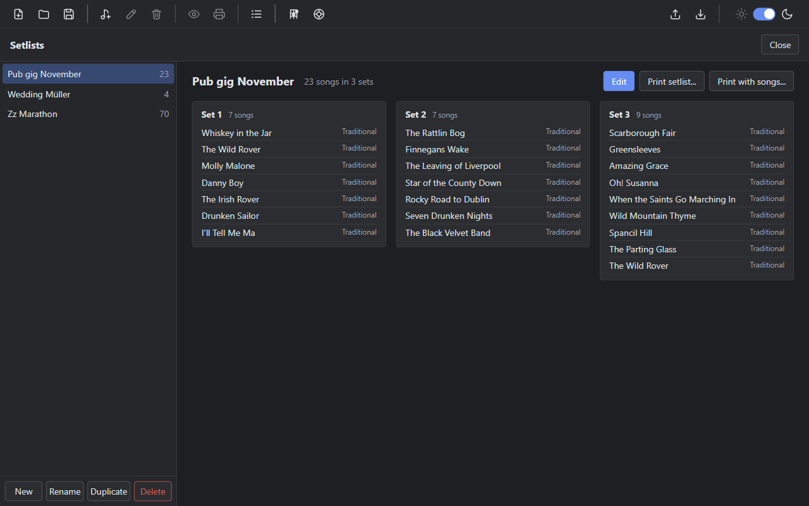
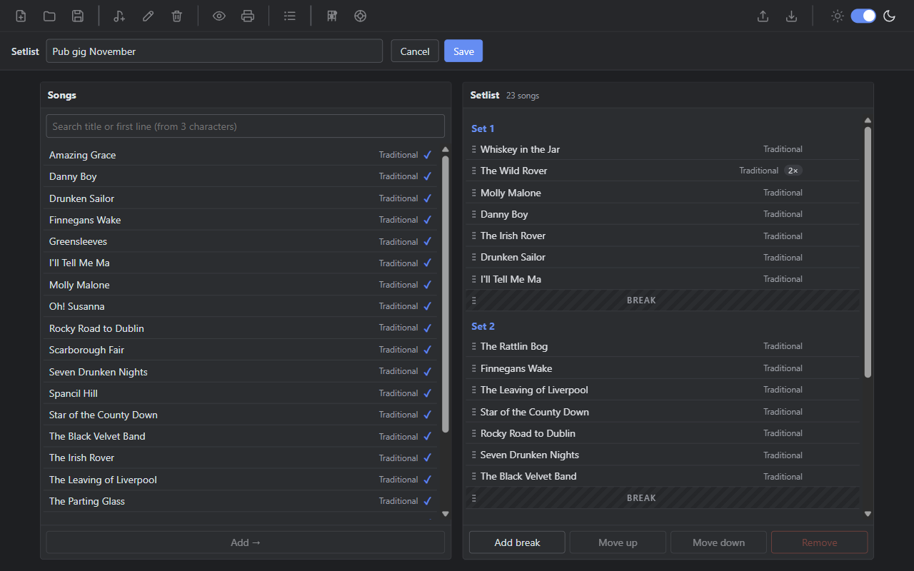
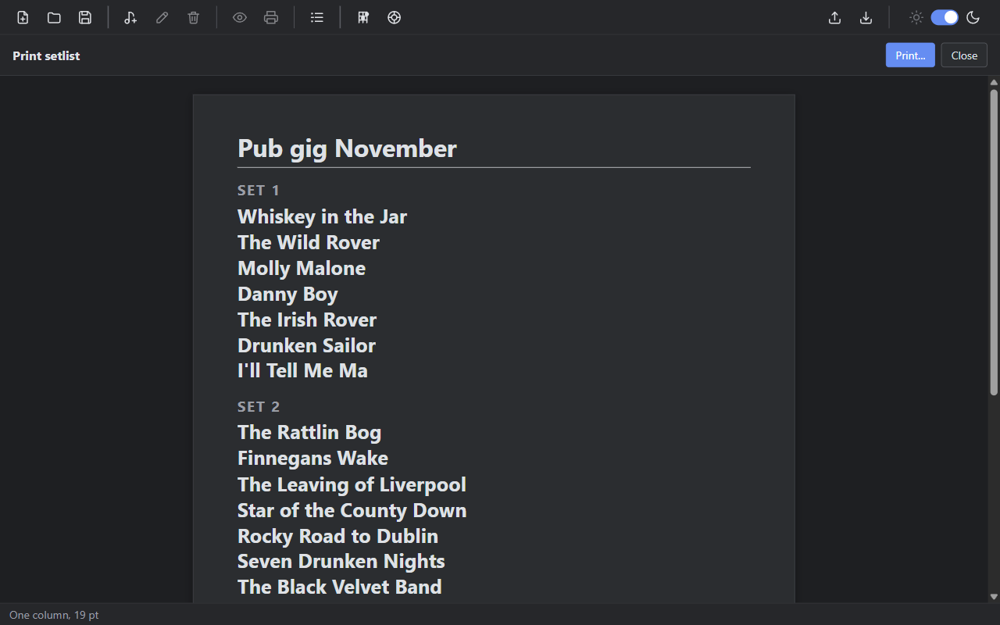

# How to build and print a setlist

A setlist is the list of songs you plan to play at a gig, in order. Breaks split it into sets: everything before the first break is Set 1, everything up to the next break is Set 2, and so on. Setlists are stored in the open `.sng` file, next to the songs.

## Open the setlists

Choose **Setlists** in the toolbar, **Songs > Setlists...**, or press `Ctrl+L`. A file must be open.

The left side lists your setlists with their song count. The right side shows the selected setlist, grouped into sets.

## Create a setlist

1. Choose **New**, enter a name such as `Pub gig November`, and choose **Create**. The editor opens.
2. Add songs from the **Songs** list on the left:
   - double-click a song, or
   - select it and press `Enter` or choose **Add →**, or
   - drag it to the place you want in the setlist.

   A new song goes after the selected setlist entry, or at the end if nothing is selected. Use the search field (3 characters or more) to find songs quickly. Songs already in the setlist have a ✓, and you can add them again, for example to play a song twice.
3. Choose **Add break** where a break should be. The break goes after the selected entry, and the next set starts below it.
4. Choose **Save**.

## Change the order

Select an entry in the setlist, then:

| Action | Ways |
|---|---|
| Move up or down | Drag the entry, the ▲ / ▼ buttons on the row, **Move up** / **Move down**, or `Alt+↑` / `Alt+↓` |
| Remove from the setlist | ✕ on the row, **Remove**, or `Delete` |
| Select the next or previous entry | `↑` / `↓` |

Breaks are moved and removed the same way as songs. A song that appears more than once shows a "2×" mark.

If a break leaves a set without songs (a break at the start or end, or two breaks in a row), the editor shows "Empty set". Such breaks are removed when you save.

To leave without saving, choose **Cancel** or press `Esc`. If you changed something, the app asks first.

## Rename, duplicate or delete a setlist

Select the setlist on the left and choose **Rename**, **Duplicate** or **Delete**. A duplicate is useful for a similar gig: copy the setlist and change only what is different. Deleting a setlist keeps all songs.

Setlist names are unique, ignoring upper and lower case.

## Print the setlist

Select the setlist and choose **Print setlist...**. The print view opens and the system print dialog follows.

The printout has the heading "Setlist", then for each set a heading ("Set 1", "Set 2", …) and the song titles. The name of the setlist is not printed; it is only used inside the app. Breaks are not printed either: the set headings show where they are.

The setlist is fitted on one sheet of A4:

1. The app picks the largest font, from 22 pt down to 12 pt, at which the whole setlist fits on the page.
2. At each size it tries one column first, then two columns. Two columns are only used if no title has to wrap.
3. A very long setlist is set in two columns even if titles wrap. Only if it still does not fit at 12 pt does it continue on a second page.

A set is never split across columns. The bar at the bottom of the print view shows the layout that was chosen, for example "One column, 19 pt". Use **Print...** to print again and **Close** to go back.

## Print the setlist with all songs

Choose **Print with songs...**. The setlist page is printed first, followed by every song in setlist order, each on a new page, with chords, chord diagrams and tabs as in the normal song print. A small line above each song shows its set, for example "Set 2".

A song that appears twice in the setlist is printed twice.

## Deleting songs that are in setlists

When you delete a song that is used in setlists, the confirmation says how many setlists contain it. Deleting the song removes it from those setlists too.

## Export and import

Setlists are part of the JSON export. When you import a file, its setlists are added after the songs:

- A setlist whose name already exists is imported under a numbered name, for example "Pub gig (2)".
- A setlist song that is not in your file is left out. The import result lists how many songs were missing per setlist.

See [How to export and import songs](how-to-export-import-songs.md) and the [export file format](reference-export-format.md).
