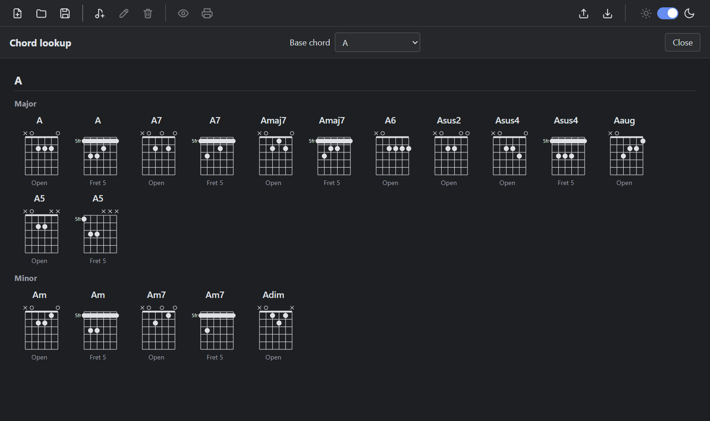

# Reference: Chord notation and diagrams

Source: [src/shared/chords.ts](../src/shared/chords.ts). Drawing: [ChordDiagram.tsx](../src/renderer/src/components/ChordDiagram.tsx).

## How chords are found in the Chords used field

The text is read line by line.

| Case | Rule |
|---|---|
| Line with a label | The text before the first colon is the label if it contains a letter and no `\|`. Every chord after the colon is used, and other words are ignored. |
| Line without a label | The line only counts if every token on it is a chord or an ignored token. Lines with ordinary words are skipped. |

Tokens are separated by spaces and by `-`, `–`, `—`, `,`, `|`, `:`, `;`, `>`, `(`, `)`, `[` and `]`.

Ignored tokens: repeat counts such as `x2`, `2x` and `2`, `%`, dots, and `N.C.` (with or without dots).

Each chord is listed once, in order of first appearance. Different spellings of the same note, such as `A#` and `Bb`, count as the same chord. The spelling that appears first is shown.

Examples:

| Input | Chords found |
|---|---|
| `Verse: C-G-Em-D` | C, G, Em, D |
| `Chorus: Em - C - G` | Em, C, G |
| `Verse: C G x2 (slowly)` | C, G |
| `Chorus: \|: Am F :\|` | Am, F |
| `G C D G` | G, C, D |
| `A bridge to cross` | none (a word on a line without a label) |

## Chord names

A chord name has this form: root, optional suffix, optional bass note.

- **Root:** a capital letter `A` to `G`, optionally followed by `#`, `b`, `♯` or `♭`.
- **Suffix:** any combination of `maj`, `min`, `m`, `M`, `dim`, `aug`, `sus`, `add`, `+`, `°`, digits, `b` and `#`.
- **Bass note:** `/` followed by a note, for example `D/F#`.

A name that is valid but not in the table below, for example `Cm7b5`, is accepted and listed, but has no diagram.

## Chord types with diagrams

| Type | Accepted suffixes |
|---|---|
| Major | (none), `maj` |
| Minor | `m`, `min` |
| Dominant seventh | `7` |
| Minor seventh | `m7`, `min7` |
| Major seventh | `maj7`, `M7` |
| Diminished | `dim`, `°` |
| Augmented | `aug`, `+` |
| Suspended | `sus`, `sus4`, `sus2` |
| Added ninth | `add9` (open C only) |
| Sixth | `6` |
| Power chord | `5` |

Slash chords have a diagram only for `D/F#`, `C/G` and `G/B`.

## Where the fingerings come from

For every chord, up to three kinds of fingering are known.

| Kind | Chords |
|---|---|
| Open shapes | Listed explicitly: C, C7, Cmaj7, Cadd9, D, Dm, D7, Dmaj7, Dm7, Dsus2, Dsus4, D6, Fmaj7, G, G7, Gmaj7, G6, B7, and the three slash chords. |
| E shape | A shape with the root on the low E string, moved up the neck. At fret 0 it is the open shape of E, Em, E7 and similar chords. |
| A shape | A shape with the root on the A string, moved up the neck. At fret 0 it is the open shape of A, Am, A7 and similar chords. |

Not every type exists in both movable shapes. `sus2`, `dim`, `aug` and `6` exist only as A shapes.

The song preview shows one fingering per chord: the open shape if there is one, otherwise the movable shape with the lowest fret. The [chord lookup page](reference-ui-and-shortcuts.md#chord-lookup-page) shows all of them.

## Reading a diagram

| Element | Meaning |
|---|---|
| Six vertical lines | The strings, low E on the left. |
| Horizontal lines | Frets. Five frets are shown. |
| Thick line at the top | The nut. It is shown when the diagram starts at the first fret. |
| Number with `fr` on the left | The fret where the diagram starts, for chords played higher up the neck. |
| `o` above a string | The string is played open. |
| `x` above a string | The string is not played. |
| Filled dot | A finger on that string and fret. |
| Wide rounded bar | A barre across several strings. |

The diagram starts at the nut unless the lowest fretted fret is above 2 or the highest is above 5.

## Chord lookup contents

| Setting | Result |
|---|---|
| Base chord `C` to `B` | The major and minor variants of that root. |
| `None (all chords)` | All 12 roots (C, C#, D, D#, E, F, F#, G, G#, A, A#, B), one below the other. |

Variants are grouped as follows. Variants without a fingering are left out.

| Group | Types |
|---|---|
| Major | major, `7`, `maj7`, `6`, `add9`, `sus2`, `sus4`, `aug`, `5` |
| Minor | `m`, `m7`, `dim` |

Under each diagram, the label says **Open** or **Fret N** (the fret of the shape's root position).
