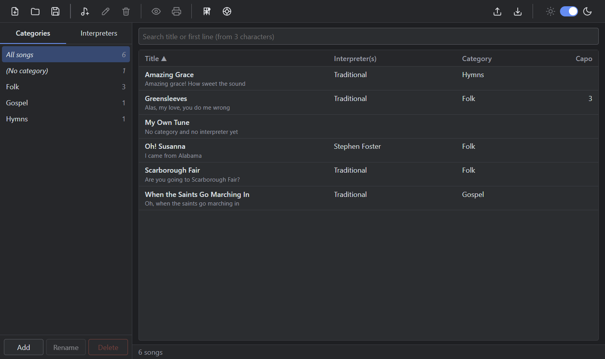
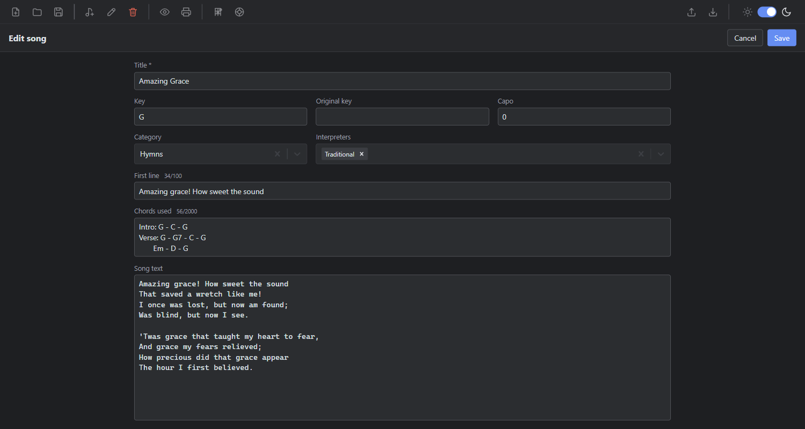
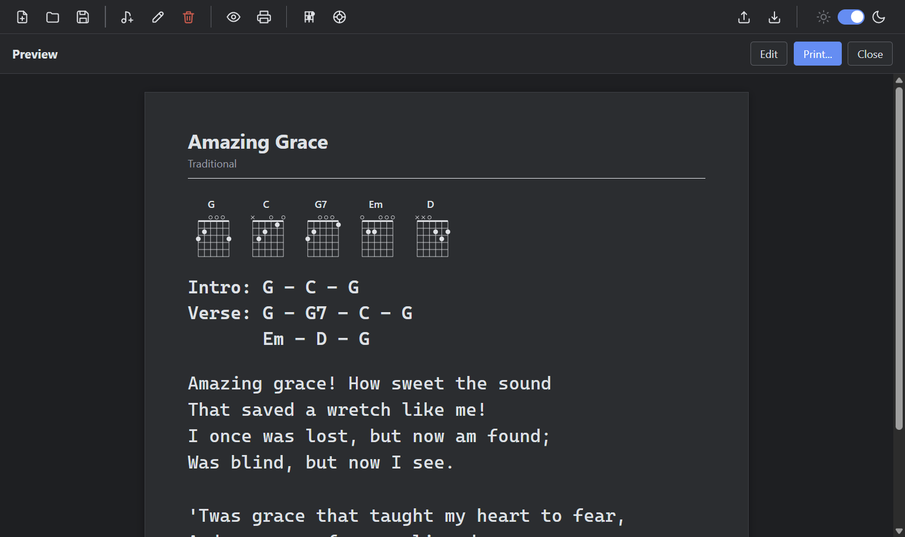
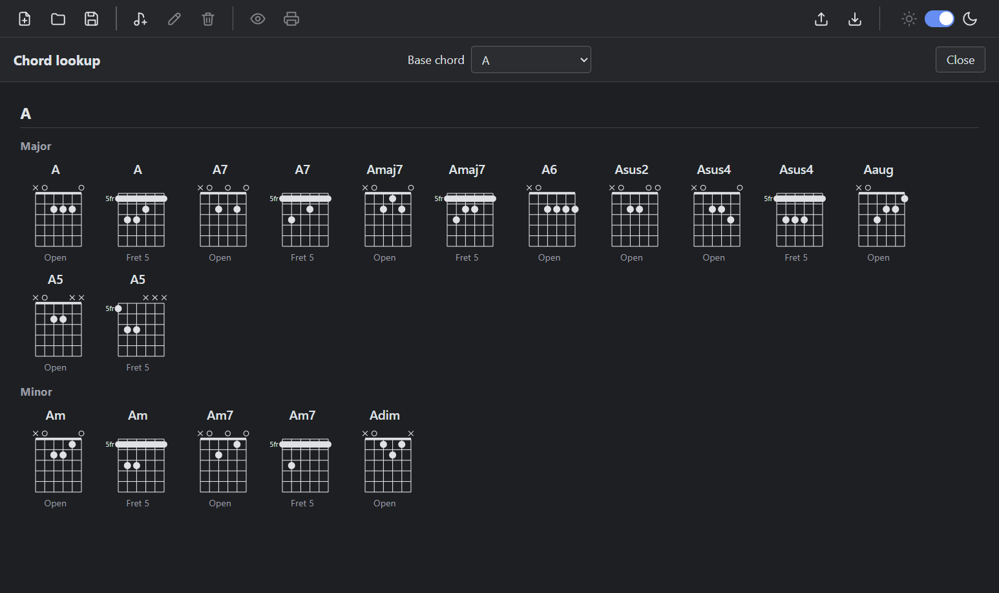
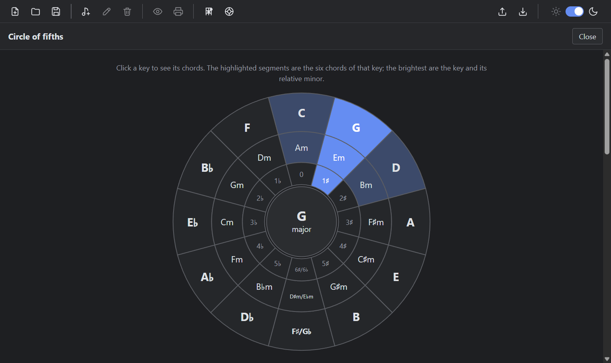

# Reference: User interface and keyboard shortcuts

## Views

| View | Description |
|---|---|
| Welcome screen | Shown when no file is open (first start, or the last file is missing). Offers New file, Open file and the recent files. |
| List | Sidebar and song list. |
| Editor | Replaces the whole window content while a song is created or edited. |
| Preview | Print-style sheet of the selected song. |
| Chord lookup | Page with chord diagrams. Opened from **View > Chord Lookup**; works with or without an open file. |
| Circle of fifths | Page with an interactive circle of fifths and an explanation. Opened from **View > Circle of Fifths**; works with or without an open file. |

## Toolbar

| Position | Button | Notes |
|---|---|---|
| Left | New file, Open file, Save file as | Save as copies the open file (SQLite `backup`). |
| Left | New song, Edit song, Delete song | Edit and Delete need a selected song. |
| Left | Preview song, Print song | Need a selected song. |
| Left | Chord lookup | Opens the [chord lookup page](#chord-lookup-page). Works without an open file. |
| Left | Circle of fifths | Opens the [circle of fifths page](#circle-of-fifths-page). Works without an open file. |
| Right | Export songs, Import songs | JSON, see [Export file format](reference-export-format.md). |
| Right | Dark / light switch | Theme is saved in the settings. |

While the editor is open, all buttons are disabled, except Delete (for an existing song) and the theme switch.

## Menu

| Menu | Commands |
|---|---|
| File | New File..., Open File..., Open Recent, Save File As..., Export Songs as JSON..., Import Songs from JSON..., Quit (Close on macOS) |
| Edit | Standard edit commands |
| Songs | New Song, Preview Song, Print Song..., Search |
| View | Dark Theme, Light Theme, Chord Lookup, Circle of Fifths, Toggle Full Screen. In development builds also Reload and Toggle Developer Tools. |

Items that work on songs and the file commands Save As, Export and Import are disabled while no file is open. Chord Lookup and Circle of Fifths are always enabled, but are ignored while a song is being edited, so unsaved changes are not lost.

## Keyboard shortcuts

`Ctrl` is `Cmd` on macOS.

| Shortcut | Action |
|---|---|
| `Ctrl+Shift+N` | New file |
| `Ctrl+O` | Open file |
| `Ctrl+Shift+S` | Save file as |
| `Ctrl+N` | New song |
| `Ctrl+Shift+P` | Preview song |
| `Ctrl+P` | Print song |
| `Ctrl+F` | Focus the search field |
| `Enter` (song list) | Edit the selected song |
| `Delete` (song list) | Delete the selected song, after confirmation |
| `Esc` (editor) | Cancel, with a prompt if there are unsaved changes |

Double-clicking a song also opens the editor.

## Sidebar

- Tabs **Categories** and **Interpreters**. Only one is active at a time.
- Each tab starts with **All songs** and a virtual entry (**(No category)** or **(No interpreter)**).
- Every entry shows its song count.
- Buttons below the list: Add, Rename selected and Delete selected (with confirmation). Rename and Delete are disabled for "All songs" and the virtual entry.

## Song list

Rows have two lines: title, interpreters, category and capo; below that, the first line in smaller text. The list is sorted by title with Unicode-aware ordering.

### Sorting

Click the **Title**, **Interpreter(s)** or **Category** header to sort the list by that column. The active column shows an arrow (▲ ascending, ▼ descending).

| Click | Result |
|---|---|
| Another header | Sorts by that column, ascending. |
| The active header | Reverses the direction. |

- The default is the title, ascending.
- Songs without a category or interpreter come first when sorting ascending and last when sorting descending.
- Songs with the same value are ordered by title, ascending, in both directions.
- The sort applies to the sidebar selection and to search results.
- The sort is not saved. It returns to the default when you open another file or restart the app.
- Sorting uses the same Unicode-aware ordering as the default list. The headers are buttons, so they can be focused with `Tab` and activated with `Enter` or `Space`.

## Search

- Starts at 3 characters (`MIN_SEARCH_LENGTH`). Shorter input falls back to the sidebar selection.
- Runs on every keystroke.
- Matches "contains" in the title and the first line.
- Is global: it ignores the sidebar selection.
- Is Unicode-aware (case-insensitive also for non-ASCII letters).

## Song editor

| Field | Type | Limit |
|---|---|---|
| Title | Text | Required, 200 characters |
| Key / Original key | Text | 10 characters |
| First line | Text | 100 characters |
| Capo | Number | 0–12, default 0 |
| Category | Single select, creatable | One category or none |
| Interpreters | Multi select, creatable | Any number |
| Chords used | Textarea, not resizable | 2000 characters. See [Chord notation](reference-chord-notation-and-diagrams.md). |
| Song text | Textarea | Unlimited |

Buttons: **Cancel** and **Save**.

## Preview and print sheet

- Title (26 px).
- Interpreters on the left, "Capo: N" on the right (only if the capo is greater than 0), 14 px.
- A rule.
- Chord diagrams (small, without a heading): one for each distinct chord found in the chords text. Hidden if no chord is found. See [Chord notation and diagrams](reference-chord-notation-and-diagrams.md).
- Chords text (bold, monospace), exactly as entered.
- Song text (monospace). Guitar tabs in the song text are drawn as tablature, see [Tab notation](reference-tab-notation.md).

The font size for chords and text is chosen so that the longest line fits the page width, between 1 rem and 1.5 rem. On screen the sheet follows the theme. Printing uses the system dialog, is always black on white, and uses 18 mm margins. The width calculation assumes A4. The chord diagrams use the text colour, so they print in black.

## Chord lookup page

Open it with **View > Chord Lookup**. Close it with the **Close** button or `Esc`.

| Area | Description |
|---|---|
| Header, left | Title "Chord lookup". |
| Header, centre | **Base chord** dropdown: None (all chords), C, D, E, F, G, A, B. |
| Header, right | **Close** button. |
| Body | One block per root, with the groups **Major** and **Minor**. Each diagram is labelled **Open** or **Fret N**. |

With a base chord selected, only that root is shown. With **None (all chords)**, all 12 roots are listed. See [Chord notation and diagrams](reference-chord-notation-and-diagrams.md#chord-lookup-contents) for the chord types in each group.

## Circle of fifths page

Open it with **View > Circle of Fifths** or the toolbar button. Close it with the **Close** button or `Esc`. The page teaches the circle of fifths, so it contains its own explanation.

| Area | Description |
|---|---|
| Header | Title "Circle of fifths" on the left, **Close** button on the right. |
| Circle | Three rings with 12 segments each: the major keys (outer ring), the relative minor keys (middle ring) and the key signature (inner ring). The bottom segment shows both spellings, F♯/G♭ and D♯m/E♭m. |
| Key details | For the selected key: its key signature and two tables with the seven chords of the key and their Roman numerals, once read as major (I ii iii IV V vi vii°) and once as the relative minor (i ii° III iv v VI VII). |
| Explanation | How to read the circle, find the chords of a key, find the key of a song, common progressions, transposing and using a capo. |

Selecting a key:

- Click any segment of a key, or focus a major key with `Tab` and press `Enter` or `Space`. C major is selected when the page opens.
- The selected key and its relative minor are highlighted brightly. The neighbouring keys (IV and V) and the minor chords below the three (ii, iii, vi) are highlighted in a lighter tone. Together these are the six chords of the key; the diminished vii° chord is only listed in the tables.
- The centre of the circle shows the selected major key.

The data comes from [src/shared/circleOfFifths.ts](../src/shared/circleOfFifths.ts).

## Theme

Dark (default) or light. The choice is saved in `settings.json` in the user data folder.
