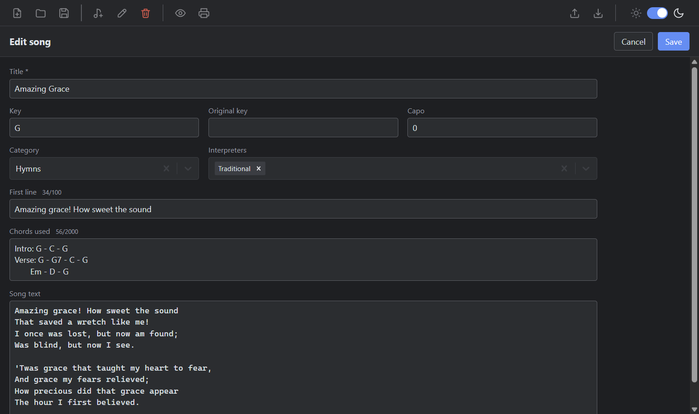
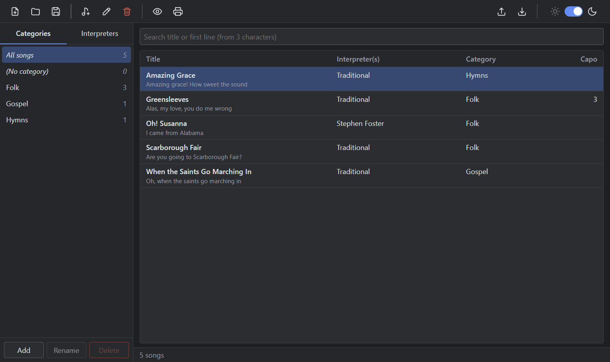
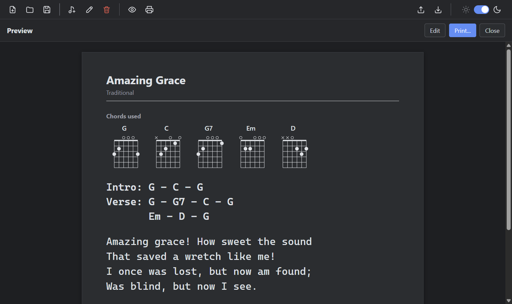
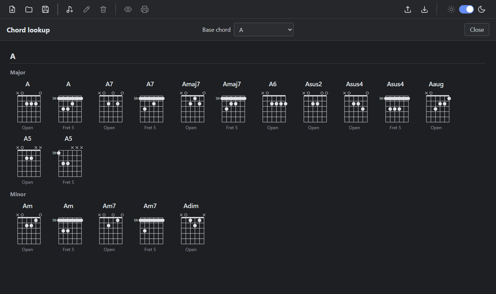

# Tutorial: Your first song

In this tutorial you create a songbook file, add your first song, find it again with the search, look at its chord diagrams, and preview and print it. You need a running copy of SimpleLyrics (see the [README](../README.md#quick-start)).

You do not need any prior knowledge of the app. The example uses "Amazing Grace", a public-domain hymn.

## 1. Create a songbook file

1. Start SimpleLyrics. On the first start you see a welcome screen (it also lists your recent files).
2. Choose **New file** (toolbar, or **File > New File...**).
3. In the dialog, pick a folder and keep the suggested name `Songs.sng`.

The window title now reads `Simple Lyrics - Songs.sng` (without an open file it reads `Simple Lyrics Manager`). Everything you enter is stored in this one file. The next time you start the app, it reopens the file automatically.

## 2. Add a song

1. Choose **New song** (toolbar, or `Ctrl+N`). The editor replaces the whole window content.
2. Enter a **title**, for example `Amazing Grace`. The title is the only required field.
3. In the category field, type `Hymns` and choose the **Create category "Hymns"** option. In the interpreters field, type `Traditional` and choose **Create interpreter "Traditional"**.
4. Set the key to `G`, leave the capo at 0 and, if you like, enter the first line `Amazing grace! How sweet the sound`.
5. In the **Chords used** field, enter:

   ```text
   Intro: G - C - G
   Verse: G - G7 - C - G
          Em - D - G
   ```

   In the song text field, enter the first verse:

   ```text
   Amazing grace! How sweet the sound
   That saved a wretch like me!
   I once was lost, but now am found;
   Was blind, but now I see.
   ```

6. Choose **Save**.



The category and interpreter are created together with the song. You are back on the song list, and the sidebar shows `Hymns` with one song.

> To leave the editor without saving, choose **Cancel** or press `Esc`. If you changed something, the app asks whether to discard the changes.

## 3. Browse and search

1. In the sidebar, switch between the **Categories** and **Interpreters** tabs. Select `Hymns` to see only its songs, or **All songs** to see everything.
2. Press `Ctrl+F` and type at least three characters of the title or first line, for example `gra`.

The list filters on every keystroke. The search covers the whole file and ignores the sidebar selection.



## 4. Preview, chord diagrams and print

1. Select the song in the list.
2. Choose **Preview song** (toolbar, or `Ctrl+Shift+P`). The sheet shows the title, the interpreters, the capo (only if it is greater than 0), a **Chords used** section, the chords text and the lyrics.
3. Look at the **Chords used** section. It shows a diagram for each chord of your chords text, here G, C, G7, Em and D. Each chord appears only once, however often you use it.
4. Choose **Print song** (toolbar, or `Ctrl+P`) to open the system print dialog.



Printing is always black on white, even if you use the dark theme.

## 5. Look up a chord

1. Choose **View > Chord Lookup**.
2. Open the **Base chord** dropdown and select `A`.

The page shows the major and minor variants of A. Chords that can be played in several places on the neck, such as A in the open position and as a barre chord at fret 5, appear once for each place.



3. Choose **Close** to go back.

## What you did

You created a songbook, stored a song with a category and an interpreter, found it with the search, saw its chord diagrams in the preview, looked up a chord, and printed the song.

## Next steps

- [Use chord diagrams](how-to-use-chord-diagrams.md)
- [Manage categories and interpreters](how-to-manage-categories-and-interpreters.md)
- [Export and import songs](how-to-export-import-songs.md)
- [User interface and keyboard shortcuts](reference-ui-and-shortcuts.md)
